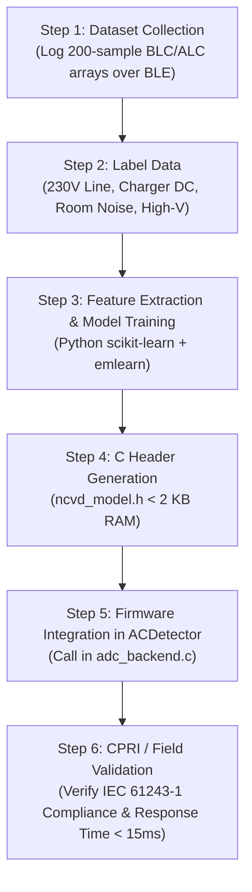

# High-Voltage NCVD: Edge AI & TinyML Implementation Plan

> **Target Platform**: Nordic Semiconductor nRF52832 (ARM Cortex-M4F @ 64 MHz, FPU, 64 KB RAM, 512 KB Flash)  
> **Firmware Framework**: Zephyr RTOS / nRF Connect SDK  
> **Firmware Path**: [ACDetector](file:///E:/projects/DevelopmentLevelCode/voltagedetection/NRF52/ACDetector)  
> **Mobile App**: [ac-detector-expo](file:///e:/projects/DevelopmentLevelCode/App/ac-detector-expo)  
> **Related Documentation**: [PROJECT_DEVELOPMENT_STATE.md](file:///E:/projects/DevelopmentLevelCode/voltagedetection/NRF52/PROJECT_DEVELOPMENT_STATE.md)  
> **Standard Compliance**: IEC 61243-1 (Capacitive Voltage Detectors > 1 kV AC)

---

## 1. Executive Summary & Objective

The Non-Contact Voltage Detector (NCVD) detects energized high-voltage conductors (230 V up to 765 kV) and hazardous capacitively induced potentials on parallel de-energized lines using a dual-channel analog front-end:
* **BLC (Before LC Filter)**: Broad-spectrum sensing plate antenna signal (`AIN7` / `P0.31`).
* **ALC (After LC Filter)**: Hardware low-pass filtered signal (`AIN4` / `P0.28`).

### Core AI Objectives
1. **Intelligent False-Alarm Suppression**: Accurately distinguish true 50 Hz power grid fields from unshielded SMPS mobile chargers, DC USB cables, variable frequency drives (VFD), corona hash, and ambient electrostatic transients.
2. **IEC 61243-1 Induced vs. Live Classification**: Recognize the harmonic and phase signature of lethal induced voltages on de-energized lines running parallel to live transmission circuits.
3. **Adaptive Environmental & Dielectric Tracking**: Dynamically adjust detection thresholds to compensate for 3D print enclosure tolerances (FDM ASA wall thickness/infill variance), ambient humidity, and temperature drift.
4. **Sub-15 ms Inference on Edge**: Execute fully on the nRF52832 Cortex-M4F without blocking the 20 ms SAADC continuous sampling window.

---

## 2. Target Classification Taxonomy

| Class ID | Class Name | Physical Source | Dominant Features | System Action |
| :---: | :--- | :--- | :--- | :--- |
| **0** | **`STATUS_SAFE`** | Ambient room static, de-energized line with no coupling | BLC RMS < 15 mV, ALC RMS < 8 mV, low coherence | Buzzer OFF, Green App Banner |
| **1** | **`STATUS_LIVE`** | Live utility conductor (230 V – 765 kV) | Clean 50 Hz fundamental, THD < 15%, 150 Hz < 10% | Continuous Siren, Solid Red LED |
| **2** | **`STATUS_INDUCED`** | Parallel transmission line capacitive coupling (10 kV – 50 kV) | 50 Hz dominant, elevated ALC/BLC ratio, phase shift | 2 Hz Beep, Flashing Red LED |
| **3** | **`SMPS_REJECT`** | Phone charger, laptop adapter, DC monopole cable | Massive 3rd harmonic (150 Hz >= 20%), high THD (> 25%) | Suppressed to SAFE (No False Alarm) |
| **4** | **`CORONA_HASH`** | High-voltage needle discharge, wet insulator leakage | Broadband high-frequency noise floor, random spikes | Filtered / Logged Warning |

---

## 3. Edge AI Deployment Models (nRF52832 Constraints)

### Comparison of Edge Approaches

| Feature | Path A: DSP Features + Random Forest (`emlearn`) | Path B: 1D-CNN (TensorFlow Lite Micro / Edge Impulse) |
| :--- | :--- | :--- |
| **Input Format** | 7–10 extracted scalar features per 20 ms window | Raw 200-sample normalized BLC + ALC arrays |
| **RAM Footprint** | **< 1.5 KB** | **6 – 10 KB** |
| **Flash Usage** | **< 4 KB** | **25 – 40 KB** |
| **Inference Time** | **< 0.5 ms** (Cortex-M4F) | **4 – 8 ms** (Cortex-M4F) |
| **Dependencies** | Pure C (zero dynamic `malloc`, single `.h` file) | C++ runtime, tensor arena allocation |
| **Recommendation** | **Phase 1: Immediate Deployment (Fastest, zero-risk)** | **Phase 2: Complex Switchyard Pattern Upgrades** |

---

## 4. Path A: Feature Engineering + Pure C Random Forest (Recommended)

### Feature Extraction Vector (Calculated per 200-sample window)

For each 20 ms buffer (200 samples @ 10 kHz), extract a 7-element feature vector:
1. `blc_rms`: True RMS of BLC channel (DC removed).
2. `alc_rms`: True RMS of ALC channel (DC removed).
3. `alc_blc_ratio`: Filter attenuation ratio (`alc_rms / blc_rms`).
4. `h3_ratio`: 150 Hz 3rd harmonic to 50 Hz fundamental ratio (`blc_150hz_rms / blc_50hz_rms`).
5. `blc_p2p`: Peak-to-Peak amplitude of BLC buffer.
6. `alc_thd`: Total Harmonic Distortion estimation on ALC channel.
7. `zero_crossings`: Number of zero-level transitions per 20 ms cycle (nominally 2 for clean 50 Hz).

### Training & Exporting Script (Python on PC)

```python
"""
ncvd_train_model.py
Train a lightweight classifier for high-voltage NCVD and export to pure C for nRF52832.
Requires: pip install scikit-learn emlearn numpy pandas
"""
import emlearn
import numpy as np
import pandas as pd
from sklearn.ensemble import RandomForestClassifier
from sklearn.metrics import classification_report
from sklearn.model_selection import train_test_split

# 1. Load labeled dataset captured over BLE
data = pd.read_csv("ncvd_dataset.csv")
feature_cols = [
    "blc_rms",
    "alc_rms",
    "alc_blc_ratio",
    "h3_ratio",
    "blc_p2p",
    "alc_thd",
    "zero_crossings",
]

X = data[feature_cols].values
y = data["label"].values  # 0: SAFE, 1: LIVE, 2: INDUCED, 3: SMPS

X_train, X_test, y_train, y_test = train_test_split(
    X, y, test_size=0.2, random_state=42, stratify=y
)

# 2. Train constrained Random Forest (optimized for Cortex-M4F memory)
clf = RandomForestClassifier(
    n_estimators=10, max_depth=5, min_samples_leaf=2, random_state=42
)
clf.fit(X_train, y_train)

# 3. Evaluate accuracy
y_pred = clf.predict(X_test)
print(classification_report(y_test, y_pred))

# 4. Export to standalone pure C header file
cmodel = emlearn.convert(clf, method="inline")
cmodel.save(file="ncvd_model.h", name="ncvd_classifier")
print("Generated ncvd_model.h successfully.")
```

---

## 5. Firmware Integration into `adc_backend.c`

### Placement in Firmware Loop
In [adc_backend.c](file:///E:/projects/DevelopmentLevelCode/voltagedetection/NRF52/ACDetector/src/adc_lib/adc_backend.c), integrate the model into the post-sampling DSP callback:

```c
#include "ncvd_model.h"

static int count_zero_crossings(int16_t *buf, int count, int32_t mean) {
    int zc = 0;
    for (int i = 1; i < count; i++) {
        int32_t prev = buf[i - 1] - mean;
        int32_t curr = buf[i] - mean;
        if ((prev < 0 && curr >= 0) || (prev >= 0 && curr < 0)) {
            zc++;
        }
    }
    return zc;
}

void evaluate_detection_ml(int32_t blc_mean, int32_t blc_rms,
                           int32_t alc_mean, int32_t alc_rms,
                           int32_t blc_50hz, int32_t blc_150hz,
                           int32_t blc_p2p, int32_t alc_p2p) 
{
    float features[7];
    features[0] = (float)blc_rms;
    features[1] = (float)alc_rms;
    features[2] = (blc_rms > 0) ? ((float)alc_rms / (float)blc_rms) : 0.0f;
    features[3] = (blc_50hz > 0) ? ((float)blc_150hz / (float)blc_50hz) : 0.0f;
    features[4] = (float)blc_p2p;
    features[5] = (alc_p2p > 0) ? ((float)alc_rms / (float)alc_p2p) : 0.0f;
    features[6] = (float)count_zero_crossings(adc_blc_buf, SAMPLE_COUNT, blc_mean);

    // Sub-millisecond TinyML prediction on ARM Cortex-M4F
    int predicted_class = ncvd_classifier_predict(features, 7);

    // Fail-safe rule: If hardware self-test indicates fault, lock into fault state
    if (g_data.hardware_fault) {
        set_annunciation_state(STATUS_FAULT);
        return;
    }

    switch (predicted_class) {
        case 1: // LIVE_GRID
            set_annunciation_state(STATUS_LIVE);
            break;
        case 2: // INDUCED_VOLTAGE
            // Only alert on ranges >= Channel 2 (3.3 kV) per IEC 61243-1
            if (g_data.selected_range >= 2) {
                set_annunciation_state(STATUS_INDUCED);
            } else {
                set_annunciation_state(STATUS_SAFE);
            }
            break;
        case 3: // SMPS Charger / DC Cable Radiation -> Suppressed
        case 0: // SAFE
        default:
            set_annunciation_state(STATUS_SAFE);
            break;
    }
}
```

---

## 6. Higher-Tier AI: Mobile App & Substation Intelligence

*Runs on Android / iOS via React Native Expo using ONNX Runtime Mobile:*

1. **Distance-to-Conductor & Voltage Estimation**:
   * Uses field gradient regression ($E = \frac{V}{d \cdot \ln(d/r)}$) across continuous dwell readings to calculate approximate physical distance to energized conductors.
2. **Predictive Range Stepping (Auto-Sweep Acceleration)**:
   * Replaces linear 11-step rotary descent with a predictive jump algorithm, homing in on the correct MUX channel within 2 steps instead of 10.
3. **Substation Multi-Phase Field Decoupling**:
   * Neural network cleans and isolates phase-to-phase crosstalk distortion caused by adjacent 3-phase busbars in compact indoor GIS or switchyard bays.

---

## 7. Action Plan & Next Steps



1. **Phase 1 (Data Capture)**: Enable raw waveform CSV logging in the mobile app during lab tests on 230 V cables and mobile charger DC cables.
2. **Phase 2 (Training)**: Run `ncvd_train_model.py` to produce the optimized `ncvd_model.h`.
3. **Phase 3 (Firmware Drop-in)**: Add `ncvd_model.h` into `ACDetector/src/adc_lib/` and wire into `evaluate_detection_ml()`.
4. **Phase 4 (Validation)**: Verify that execution latency is under 1 ms using `k_cycle_get_32()` and confirm zero false alarms on charger cables.
